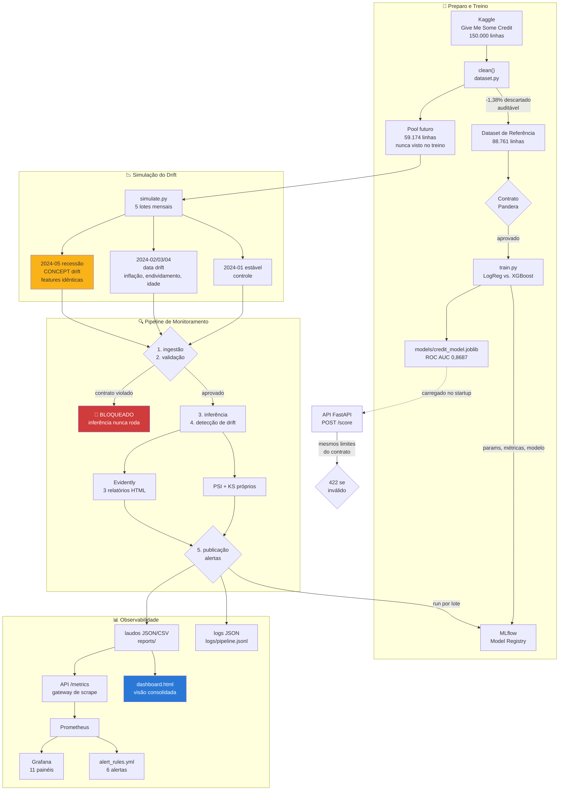

# credit-scoring-observability

Camada de **sustentação e confiabilidade** para um modelo de Credit Scoring em produção: contratos de qualidade de dados (Pandera), simulação e detecção de Data/Concept Drift (Evidently AI), observabilidade de pipeline e modelo (MLflow + Prometheus/Grafana) e governança sob a LGPD. Projeto desenvolvido para o Tech Challenge da Fase 4 do curso de Machine Learning Engineering da FIAP.

Para um resumo rápido, também temos um 🎥 [Vídeo Explicativo em menos de 5 min (método STAR)](#-vídeo-explicativo)

---


## 👥 Integrantes

| Nome | RM | Contato |
|--|--|--|
| Gustavo Dell Anhol Oliveira | RM372138 | [Github](https://github.com/gudaoliveira) - [Linkedin](https://www.linkedin.com/in/gustavodell/) |
| Patrick Kwan | RM373172 | [Github](https://github.com/ptkwan) - [Linkedin](https://www.linkedin.com/in/patrick-kwan-617296220/) |

## 🎯 O problema

Uma fintech de crédito tem um modelo de scoring em produção. A economia mudou — inflação, novos perfis de cliente — e a diretoria suspeita que o modelo está errando. Ninguém sabe dizer se está, nem desde quando, nem por quê.

Este projeto constrói a camada que responde a essas três perguntas. E o achado central é incômodo:

> **O lote mais caro da simulação é aquele em que todos os testes de drift de dados dão verde.** Na recessão simulada, o PSI máximo é **0,002**, nenhum p-valor de KS é significativo — e a inadimplência dentro da carteira **aprovada pelo modelo** salta de 2,00% para 4,48%. Um painel de data drift mostraria tudo em ordem enquanto a carteira dobra de prejuízo.

É a degradação silenciosa. Detectá-la exige cruzar monitoramento de dados com monitoramento de desempenho — nenhum dos dois sozinho basta.

## 📋 Requisitos

- Python 3.12 ou 3.13
- `uv` instalado para gerenciamento de dependências
    - Aprenda como instalar o `uv` [aqui](https://docs.astral.sh/uv/getting-started/installation/)
- Docker + Docker Compose (para subir a stack de API + MLflow + Prometheus + Grafana)
- `Makefile` para comandos de conveniência (opcional, mas recomendado)
    - No Windows, você pode usar o [Windows Subsystem for Linux (WSL)](https://learn.microsoft.com/en-us/windows/wsl/install) para acessar o `Makefile`.

## ⚙️ Setup

Realize o clone do repositório com

```bash
git clone https://github.com/fiap-postech-ml-engineering/credit-scoring-observability

cd credit-scoring-observability
```

Crie o ambiente virtual

```bash
uv venv

#############################################
# Para acessar o ambiente virtual
Windows 		-> .venv\Scripts\activate
Linux / macOS 	-> source .venv/bin/activate
```

Instale as dependências com:

```bash
# (para dependências de produção)
uv sync

# (para dependências de desenvolvimento: lint, testes e type-check)
uv sync --extra dev --extra lint --extra test --extra typecheck
```

E rode o projeto inteiro com um comando:

```bash
make pipeline
```

Em cerca de dois minutos isso baixa o dataset, treina o baseline, demonstra o contrato bloqueando um lote corrompido, gera os cinco lotes mensais com drift, roda a detecção e abre o caminho do dashboard consolidado.

## 📁 Organização do projeto

```
├── Dockerfile              <- Build multi-stage (base -> builder -> runtime) da API
├── docker-compose.yml      <- Orquestra api + mlflow + prometheus + grafana
├── LICENSE                 <- Licença open-source do projeto
├── Makefile                <- Comandos utilitários (`make pipeline`, `make check`)
├── README.md               <- Este arquivo
│
├── data
│   ├── raw                  <- cs-training.csv baixado do Kaggle
│   ├── reference            <- Dataset de Referência (88.761 linhas, usado no treino)
│   └── production           <- Pool futuro + os cinco lotes mensais com drift
│
├── docs
│   ├── data_contracts.md       <- Etapa 1: regras, transformação e o portão em ação
│   ├── drift_detection.md      <- Etapa 2: simulação, PSI/KS e resultados por lote
│   ├── observability.md        <- Etapa 3: logs, MLflow, métricas e alertas
│   ├── causal_analysis.md      <- Análise causal: experimento de atribuição 2x2
│   └── governance_lgpd.md      <- Etapa 4: LGPD, base legal, vieses e retenção
│
├── models                  <- Artefato treinado (`credit_model.joblib`)
├── notebooks
│   └── analise_credit_scoring.ipynb  <- EDA, limpeza, modelo, drift e causalidade — visual, não é entregável do enunciado
│
├── observability
│   ├── prometheus.yml       <- Configuração de scrape
│   ├── alert_rules.yml      <- Regras de alerta de drift e de pipeline
│   └── grafana
│       ├── dashboards/       <- Dashboard "Credit Scoring — Drift & Observabilidade"
│       └── provisioning/     <- Datasource e provisioning automático
│
├── reports                 <- Dashboard HTML, relatórios Evidently e laudos JSON/CSV
├── pyproject.toml          <- Dependências (uv) e ferramentas (ruff, pytest, ty)
│
├── src
│   ├── config
│   │   └── settings.py      <- Caminhos, features e limiares de alerta
│   │
│   ├── contracts            <- ETAPA 1: qualidade de dados
│   │   ├── schemas.py        <- Contratos Pandera (10 regras rígidas)
│   │   ├── validate.py       <- Portão: `enforce` bloqueia a ingestão
│   │   └── bad_batch.py      <- Gerador de lote com 11 defeitos injetados
│   │
│   ├── credit_scoring       <- Modelo baseline
│   │   ├── dataset.py        <- Ingestão, limpeza auditável e split Referência/futuro
│   │   ├── metrics.py        <- ROC AUC, KS, Brier e inadimplência da carteira aprovada
│   │   └── train.py          <- Compara LogisticRegression vs. XGBoost, registra no MLflow
│   │
│   ├── drift                <- ETAPA 2: simulação e detecção
│   │   ├── simulate.py       <- Os cinco cenários mensais (data e concept drift)
│   │   ├── statistics.py     <- PSI e KS implementados à mão
│   │   ├── detect.py         <- Relatórios Evidently + laudo estruturado
│   │   └── attribution.py    <- Experimento causal 2x2: quanto é data, quanto é concept
│   │
│   ├── observability        <- ETAPA 3: logs, rastreamento e métricas
│   │   ├── logging_setup.py  <- Logging estruturado em JSON Lines
│   │   ├── tracking.py       <- Runs de treino e de monitoramento no MLflow
│   │   └── metrics.py        <- Métricas Prometheus + collectors que leem os laudos
│   │
│   ├── pipeline             <- Orquestração
│   │   ├── monitor.py        <- As 5 tarefas por lote, cronometradas e logadas
│   │   ├── run.py            <- Execução ponta a ponta
│   │   ├── dashboard.py      <- Dashboard HTML consolidado
│   │   └── charts.py         <- SVGs do dashboard (sem dependência de JS externo)
│   │
│   └── api                  <- API FastAPI: decisão + gateway de métricas
│       ├── api.py            <- Aplicação (lifespan carrega o modelo no startup)
│       ├── routes.py         <- `/health`, `/score`, `/metrics`, `/monitoring/summary`
│       ├── schemas.py        <- Schemas Pydantic com os limites do contrato
│       ├── inference.py      <- Carregamento do modelo e decisão
│       └── middleware.py     <- Log e métricas por requisição
│
└── tests                   <- 98 testes (pytest), markers contracts/drift/model/api
```

## 📚 Documentações

- [Contratos de Dados](docs/data_contracts.md) — por que Pandera, as 10 regras, a transformação auditável e o portão bloqueando um lote corrompido
- [Simulação e Detecção de Drift](docs/drift_detection.md) — os cinco cenários, PSI vs. KS e o resultado lote a lote
- [Observabilidade](docs/observability.md) — logs estruturados, MLflow, as métricas de saúde documentadas e os alertas
- [Análise Causal](docs/causal_analysis.md) — o experimento fatorial que separa data drift de concept drift
- [Governança e LGPD](docs/governance_lgpd.md) — base legal, decisão automatizada, vieses, retenção e segurança
- [Notebook de Análise](notebooks/analise_credit_scoring.ipynb) — não é exigido pelo enunciado, mas reúne EDA, limpeza, modelo, os cinco lotes de drift e a atribuição causal visualmente, num só lugar

## 🔄 Fluxograma do projeto



## 🚀 Execução do projeto

Depois do [Setup](#️-setup):

```bash
# tudo de uma vez: dados -> treino -> contrato -> drift -> relatórios
make pipeline

# ou passo a passo
make data          # baixa e separa Referência / pool futuro
make train         # treina o baseline e registra no MLflow
make contracts     # demonstra o contrato bloqueando um lote corrompido
make drift         # gera os cinco lotes mensais
make attribution   # experimento causal: quanto é data, quanto é concept

# serviços
make stack         # API + MLflow + Prometheus + Grafana via Docker
make mlflow        # só a UI do MLflow, local
make api           # só a API, local
```

| Serviço | URL | Descrição |
|---|---|---|
| API | http://localhost:8000 | `/health`, `/score`, `/metrics`, `/monitoring/summary`, `/docs` |
| MLflow | http://localhost:5000 | Runs de treino e de monitoramento, Model Registry |
| Prometheus | http://localhost:9090 | Scrape de `api:8000/metrics` a cada 15s, 6 regras de alerta |
| Grafana | http://localhost:3000 | Login `admin`/`admin` — dashboard provisionado |
| Dashboard HTML | `reports/dashboard.html` | Visão consolidada, offline, tema claro e escuro |

---

## 🛡️ Etapa 1 — Validação de Dados e Contratos

**Biblioteca: Pandera.** Code-first, tipado, roda no CI em menos de um segundo, e os limites são importados tanto pelos schemas da API quanto pelo gerador de lotes inválidos — um único lugar define que a idade mínima é 18.

**Dez regras rígidas**, derivadas da análise do dado bruto: idade entre 18 e 100; renda não nula e dentro de faixa; endividamento e utilização de crédito como proporções plausíveis; contadores de atraso sem os sentinelas 96/98 do sistema legado; alvo estritamente binário; sem duplicatas; sem coluna fora do contrato.

**O dado bruto viola nove delas** — 21,4% das linhas. Isso não é defeito da demonstração, é o ponto dela: o contrato foi escrito a partir do que o negócio aceita, e o dado real não cumpre. A etapa de transformação é a ponte, e ela registra cada decisão (29.134 rendas imputadas, 28.844 endividamentos winsorizados, 2.065 linhas descartadas) como métrica de pipeline.

**O portão em ação.** `src/contracts/bad_batch.py` monta um lote com **11 defeitos injetados**, um por regra — incluindo uma coluna `cpf` que um upstream desavisado anexaria:

```
lote_corrompido: 530 linhas, 167 violações em 14 regras, 25,5% reprovado
status do pipeline: BLOQUEADA
tarefas inferencia / deteccao_drift / publicacao: BLOQUEADAS
```

Nenhuma linha chegou ao modelo. Um teste de regressão falha se alguém afrouxar uma regra, e no CI isso é um job com nome próprio (`contracts-gate`).

**O contrato também vale na borda:** os schemas Pydantic da API importam as mesmas constantes. Proposta com idade 15 recebe **422** e o modelo nunca é chamado.

→ Detalhes em [`docs/data_contracts.md`](docs/data_contracts.md)

---

## 📉 Etapa 2 — Simulação e Detecção de Drift

**Referência vs. Produção.** 88.761 linhas para o treino, 59.174 num pool futuro que o treino nunca vê. Split estratificado, mesma distribuição — qualquer drift medido depois foi introduzido de propósito. O lote de controle comprova: PSI de 0,002, zero alertas, **nenhum falso positivo**.

**Cinco lotes mensais**, do mês estável à recessão:

| Lote | Tipo | ROC AUC | Δ AUC | PSI máx | nº em drift | Inadimpl. aprovada | Alertas |
|---|---|---|---|---|---|---|---|
| `2024-01_estavel` | nenhum | 0,8711 | **+0,0024** | 0,002 | 0 | 1,71% | — |
| `2024-02_inflacao_leve` | data | 0,8619 | −0,0068 | 0,055 | 0 | 1,97% | — |
| `2024-03_inflacao_forte` | data | 0,8311 | −0,0376 | **0,467** | 2 | 1,92% | queda, drift de feature |
| `2024-04_novo_perfil` | data+cov | 0,8254 | −0,0432 | **0,549** | 3 | 1,79% | queda, drift de dataset, drift de feature |
| `2024-05_recessao` | **concept** | 0,8233 | −0,0454 | **0,002** | **0** | **4,48%** | **degradação silenciosa**, queda |

**Compare as duas últimas linhas.** A queda de AUC é praticamente a mesma (−0,0432 vs. −0,0454). Mas em `2024-04` o PSI grita 0,549 com três features em drift, enquanto em `2024-05` o PSI é 0,002 e *nenhum* p-valor de KS é significativo — as features são estatisticamente indistinguíveis da Referência. E ainda assim `2024-05` é o lote mais caro: 2,25× o prejuízo na carteira aprovada.

**PSI é o critério, KS é apoio.** Com 8.000 linhas por lote, qualquer teste de hipótese rejeita igualdade por diferenças irrelevantes. O PSI não depende do tamanho da amostra — e um teste formaliza isso.

**Relatórios gerados** por lote: `DataDriftPreset`, `ClassificationPreset` (o único que vê concept drift) e `DataSummaryPreset` do Evidently, mais o laudo estatístico próprio em CSV e o resumo em JSON.

→ Detalhes em [`docs/drift_detection.md`](docs/drift_detection.md)

---

## 📊 Etapa 3 — Observabilidade de Pipelines e Modelos

**Três camadas:** logs estruturados em JSON Lines, rastreamento de ciclo de vida no **MLflow** (runs de `training` e de `monitoring`, com Model Registry) e métricas no **Prometheus/Grafana**.

**O problema arquitetural e a solução.** O monitoramento de drift é um job *batch*, e o Prometheus só raspa alvos que estão de pé — um processo que roda e morre nunca é raspado. Em vez de subir um Pushgateway, **a API é o gateway de métricas**: um collector customizado lê, no momento do scrape, os laudos JSON que o pipeline deixou em `reports/`. Um único alvo expõe métricas ao vivo e métricas de batch, e reiniciar a API não perde histórico.

**Métricas de saúde documentadas** — pipeline (status e duração por tarefa, volume processado, timestamp da última execução), qualidade de dados (aprovação no contrato, violações por regra, taxa de rejeição), modelo (PSI por feature, features em drift, AUC, variação contra a baseline, alertas) e API (requisições, latência fim a fim, latência de inferência, distribuição de scores, decisões emitidas).

**Seis alertas**, sendo quatro críticos. O mais importante:

```yaml
- alert: DegradacaoSilenciosa
  expr: credit_silent_degradation > 0
  annotations:
    summary: "Degradação silenciosa no lote {{ $labels.batch }}"
```

Esse alerta **só existe porque cruzamos as duas fontes**. Nenhum monitor de distribuição sozinho consegue levantá-lo.

**Dois dashboards:** 11 painéis no Grafana (provisionados automaticamente) e um HTML consolidado de 46 KB que abre offline, com tema claro e escuro — a visão de cima que quinze relatórios separados não dão.

→ Detalhes em [`docs/observability.md`](docs/observability.md)

---

## 🔬 Análise Causal da Degradação

"O AUC caiu 0,045" é sintoma, não diagnóstico. **Por qual mecanismo** caiu importa, porque a resposta é diferente: data drift (`P(X)` mudou, `P(Y|X)` vale) pede recalibração; concept drift (`P(Y|X)` mudou) exige retreino — recalibrar não resolve.

**O modelo causal.** O choque macroeconômico é a causa comum de dois caminhos: ele desloca as features medidas (renda nominal ↑, endividamento ↑, base mais jovem) **e** altera a propensão real a inadimplir para o mesmo perfil. O modelo não observa "estamos numa recessão" — vê só renda, idade e endividamento. Por isso um modelo treinado num regime econômico tem validade limitada a esse regime.

**O experimento.** Como controlamos o processo gerador, dá para rodar o desenho fatorial 2×2: cada mecanismo isolado, mesma amostra-base, mesma semente.

| Condição | `P(X)` | `P(Y\|X)` | ROC AUC | Δ AUC | Inadimplência | Carteira aprovada ruim | PSI máx |
|---|---|---|---|---|---|---|---|
| controle | — | — | 0,8691 | **+0,0005** | 6,69% | 1,94% | 0,002 |
| só data drift | muda | intacta | 0,8398 | −0,0289 | 6,69% | 1,66% | **0,561** |
| só concept drift | intacta | muda | 0,8193 | −0,0494 | 10,47% | 4,66% | **0,002** |
| ambos | muda | muda | 0,7196 | **−0,1490** | 17,46% | **10,02%** | 0,561 |

O controle move o AUC em +0,0005 (ruído desprezível) e, em "só data drift", a inadimplência fica idêntica ao controle — confirmando que `P(Y|X)` foi mesmo preservada. O desenho está limpo.

**Três conclusões:**

1. **O mecanismo dominante é o invisível.** O concept drift responde por **63%** do dano isolado — e é justamente o que produz PSI de 0,002. Monitorar só distribuição de features capturaria 37% do problema e deixaria passar a maior parte, em silêncio. É a justificativa quantitativa para a arquitetura deste projeto.

2. **Os mecanismos se potencializam.** O efeito conjunto (−0,1490) é muito pior que a soma dos isolados (−0,0793): a **interação vale −0,0702**, sozinha maior que qualquer efeito isolado. Quando a base já se deslocou para fora do domínio de treino, o modelo fica *mais* vulnerável a uma mudança de relação. Não dá para estimar o risco de uma recessão somando efeitos observados isoladamente.

3. **O custo real não está no AUC.** No cenário combinado, a inadimplência dentro da carteira **aprovada** vai de 1,94% para **10,02%** — 5,2× o prejuízo — com a taxa de aprovação praticamente intacta. O modelo aprova a mesma fatia de gente; é a qualidade dessa fatia que desmoronou. Por isso `approved_bad_rate` é métrica de primeira classe no dashboard.

**Uma ressalva honesta:** a atribuição limpa é possível porque *nós* geramos o drift. Em produção o rótulo chega com atraso (1 a 2 anos no crédito), e esse atraso é o obstáculo real. O que este projeto entrega é a camada que torna o diagnóstico possível assim que o rótulo chegar.

→ Detalhes em [`docs/causal_analysis.md`](docs/causal_analysis.md)

---

## ⚖️ Etapa 4 — Governança e LGPD

### Inventário e minimização

O modelo usa dez atributos econômico-financeiros e demográficos. **Nenhum dado pessoal sensível** na definição do art. 5º, II da LGPD — sem origem racial, convicção religiosa, opinião política, saúde, dado genético ou biométrico. E **nenhum identificador direto**: sem CPF, nome, endereço, telefone ou número de conta.

Isso é aplicado **tecnicamente, não por convenção**: `strict=True` nos contratos Pandera recusa qualquer coluna não declarada. Um upstream que anexe um CPF ao lote tem a ingestão bloqueada — e a injeção `coluna_inesperada` dos testes usa justamente uma coluna `cpf` para garantir que a regra não regrida. É *privacy by design* no sentido literal: a arquitetura torna o vazamento de PII uma falha ruidosa em vez de um descuido silencioso.

> **Limite honesto:** os atributos são pseudonimizados, não anonimizados. Renda, idade, dependentes e histórico de crédito combinados podem ser reidentificáveis. Continuam sendo dados pessoais, e todo o regime da LGPD se aplica.

### Base legal (art. 7º)

Duas bases se combinam: **art. 7º, V** (execução de contrato e procedimentos preliminares) — a análise de risco é condição prévia à concessão — e **art. 7º, IX** (legítimo interesse), que sustenta o monitoramento contínuo e exige teste de proporcionalidade documentado no RIPD.

**Consentimento (art. 7º, I) não é a base adequada**, e usá-lo seria um erro comum: consentimento precisa ser livre e revogável, e numa relação em que negar o tratamento inviabiliza o produto ele não é livre. Invocá-lo criaria uma base frágil e um direito de revogação que a instituição não consegue honrar sem encerrar o contrato.

No contexto brasileiro, o histórico de pagamentos compõe o escore sob o regime próprio da Lei 12.414/2011 (cadastro positivo, com a redação da LC 166/2019), com direitos específicos de acesso e revisão.

### Decisão automatizada (art. 20)

O titular tem direito a revisão de decisões automatizadas que afetem seus interesses — e crédito negado afeta.

**Implementado:** toda resposta da API devolve a probabilidade, a decisão, o limiar aplicado e qual modelo decidiu; o MLflow guarda qual versão estava em produção, com quais parâmetros e sobre quais dados foi treinada; os limiares são configuração versionada, não número mágico no código.

**Necessário em produção, fora do escopo desta fase:** canal formal de contestação com revisão humana e prazo, explicação individual por decisão (SHAP ou equivalente) em linguagem acessível, e registro auditável de cada decisão emitida.

### Vieses e mitigação

O modelo usa **idade**, que carrega peso real (PSI de 0,549 no lote `2024-04`) e é critério protegido em várias jurisdições. O próprio cenário de concept drift é, no fundo, um achado de equidade: o modelo **subestimava sistematicamente** o risco de jovens sem patrimônio imobiliário — o que vira prejuízo para a fintech e crédito impagável para o cliente.

**O que não dá para verificar:** o Give Me Some Credit não traz gênero, raça, região ou estado civil. Este projeto **não consegue** medir disparidade entre grupos protegidos, e dizer o contrário seria falso. Ausência de atributo não é ausência de viés — renda, endividamento e CEP funcionam como proxies de raça e classe em qualquer carteira de crédito brasileira.

**Plano para produção:** coletar atributos protegidos separadamente, com base legal própria e acesso restrito, **apenas para auditoria de equidade**, nunca como feature; medir taxa de aprovação, falso positivo/negativo e calibração por grupo no mesmo pipeline que hoje mede PSI; definir limiar de disparidade com compliance e tratá-lo como os alertas de drift; revisar com o jurídico se o ganho preditivo da idade justifica o risco regulatório; e **testar proxies** — treinar um classificador para prever o atributo protegido a partir das features; se ele acerta bem, remover o atributo direto não resolve nada.

### Retenção e eliminação (arts. 15, 16 e 18)

| Dado | Retenção | Justificativa |
|---|---|---|
| Dataset de Referência | enquanto o modelo estiver em produção + 5 anos | auditoria da decisão |
| Lotes de produção rotulados | 5 anos após o fim do contrato | prazo do Código Civil; base de retreino |
| Score e decisão por proposta | 5 anos | direito de revisão (art. 20) e defesa |
| Laudos de drift e métricas | 5 anos | **agregado, sem titular identificável** |
| Logs do pipeline | 12 meses | depuração; sem dado de titular |
| Propostas recusadas | 2 anos | reject inference e contestação |
| Modelos no MLflow Registry | indefinido (metadados) | linhagem; sem dado pessoal |

**Sobre o direito de eliminação:** pedidos são atendidos nos dados operacionais, mas é preciso ser honesto — **um modelo já treinado não "desaprende" um indivíduo**. A mitigação praticável é retreinar sem o titular no próximo ciclo programado, e a política precisa declarar isso em vez de prometer uma eliminação que a tecnologia não entrega.

### Segurança (art. 46)

Container como usuário **não-root**, build multi-stage sem ferramentas de build na imagem final, dependências travadas em `uv.lock` com `--frozen`, **CodeQL** (`security-extended`) e **zizmor** no CI, actions fixadas por SHA, segredos fora do repositório. O próprio contrato de dados é controle de segurança: barra injeção de coluna inesperada.

### Lacunas declaradas

Não há revisão humana formalizada, não há explicação individual por decisão, e o dataset público não permite auditoria de equidade entre grupos protegidos. As três são pré-requisitos para operação real e estão endereçadas no plano acima — declaradas, não escondidas.

→ Detalhes em [`docs/governance_lgpd.md`](docs/governance_lgpd.md)

---

## 📈 Relatórios gerados

Rodar `make pipeline` produz, em `reports/`:

| Arquivo | Conteúdo |
|---|---|
| `dashboard.html` | **Comece por aqui.** Visão consolidada: KPIs, heatmap de PSI, séries de AUC e inadimplência, alertas, status das tarefas e tabela completa |
| `{lote}__data_drift.html` | Relatório Evidently de data drift, feature a feature |
| `{lote}__classification.html` | Relatório Evidently de qualidade — o único que enxerga concept drift |
| `{lote}__data_summary.html` | Sanidade do lote |
| `{lote}__psi_ks.csv` | Laudo estatístico próprio: PSI, KS, p-valor e severidade por feature |
| `{lote}__drift.json` | Resumo estruturado consumido por MLflow, Prometheus e dashboard |
| `lote_corrompido__validation.json` | Laudo da rejeição pelo contrato |
| `lote_corrompido__manifest.json` | Cruza "o que foi injetado" com "o que o contrato pegou" |
| `atribuicao_causal.json` | Experimento fatorial e a decomposição da degradação |
| `pipeline_runs.json` | Histórico de execuções: status e duração por tarefa |

Os HTMLs do Evidently pesam ~4 MB cada e são todos reproduzíveis com um comando, então o repositório versiona o dashboard consolidado, os laudos textuais (diffáveis) e **dois relatórios do Evidently escolhidos a dedo** — o de data drift do lote `2024-04_novo_perfil` (drift alto e visível) e o de classificação do `2024-05_recessao` (a degradação silenciosa). Os outros treze são gerados localmente.

## ✅ Qualidade

**Testes.** 98 testes com **87% de cobertura**, rodando sobre dados sintéticos determinísticos — sem chamada ao Kaggle, sem artefato pré-treinado, sem rede. Markers: `contracts`, `drift`, `model`, `api`, `integration`.

Dois testes merecem destaque porque formalizam as teses do projeto:

- `test_concept_drift_e_invisivel_para_o_psi` — se alguém "melhorar" a simulação e isso quebrar, a demonstração perdeu o sentido;
- `test_lotes_com_data_drift_continuam_validos_no_contrato` — drift **não** é dado inválido. Dado inválido é lixo, barra; dado em drift é informação legítima de um mundo que mudou, deixa entrar e mede. Barrar drift seria cegar o monitoramento exatamente quando ele mais importa.

**CI/CD.** `.github/workflows/ci.yml` roda a cada push/PR: lint e format (Ruff), type check (`ty`), testes em Python 3.12 e 3.13, o job dedicado `contracts-gate` (para afrouxar uma regra do contrato aparecer como falha nomeada no PR, não escondida no meio da suíte), build da imagem Docker e cobertura agregada no summary. Um job final (`all-checks-pass`) bloqueia merge se qualquer etapa falhar. Mais CodeQL e zizmor em workflows próprios.

```bash
make check       # lint + format + testes
make test-cov    # testes com relatório de cobertura em HTML
```

## 🎥 Vídeo Explicativo

*(link a ser adicionado após a gravação)*

**Situation** — uma fintech tem um modelo de crédito em produção e a economia mudou. A diretoria suspeita que ele está errando, mas ninguém consegue provar se está, desde quando, nem por quê. Degradação silenciosa é o pior tipo: não gera erro, não cai o serviço, só queima dinheiro.

**Task** — construir a camada de sustentação: interceptar dado ruim antes do modelo, detectar drift estatisticamente, e garantir que tudo esteja sob regras de governança e privacidade.

**Action** — Pandera para dez contratos rígidos que bloqueiam a ingestão; cinco lotes mensais simulando inflação, novo perfil de cliente e recessão; PSI e KS próprios mais os relatórios do Evidently; MLflow rastreando o ciclo de vida e Prometheus/Grafana expondo a saúde do pipeline, com a API atuando como gateway de métricas do job batch.

**Result** — o contrato bloqueou 11 defeitos injetados e nenhuma linha ruim chegou ao modelo. O detector pegou o drift de dados nos lotes de inflação e novo perfil. E o achado que organiza o projeto inteiro: no lote de recessão, **PSI de 0,002 com todos os testes verdes, e 2,25× mais prejuízo na carteira aprovada**. O experimento causal mostrou que 63% da degradação vem justamente do mecanismo que o monitoramento de dados não enxerga. **Lição aprendida: monitorar distribuição de features é metade do trabalho — e é a metade menor.**

## Licença

MIT — ver [LICENSE](LICENSE).
